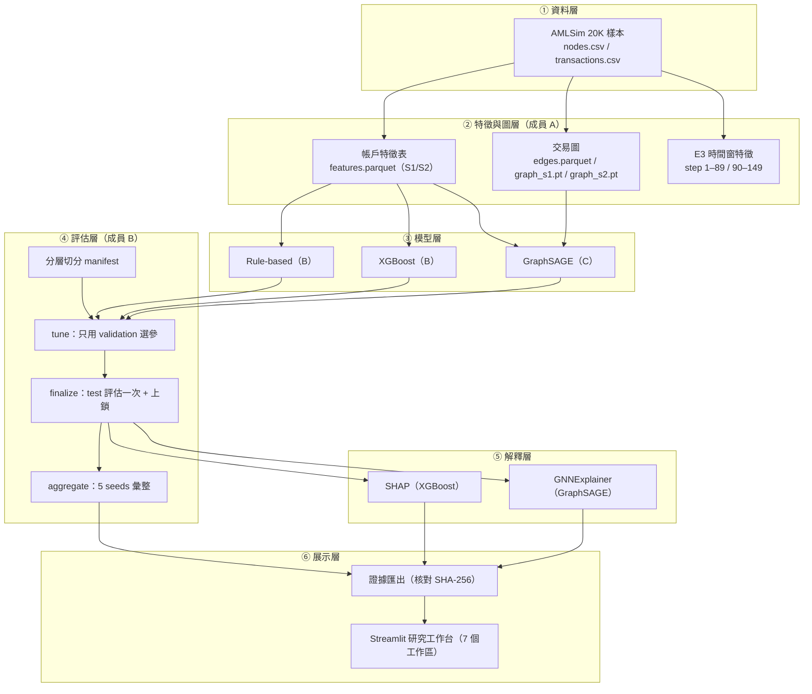
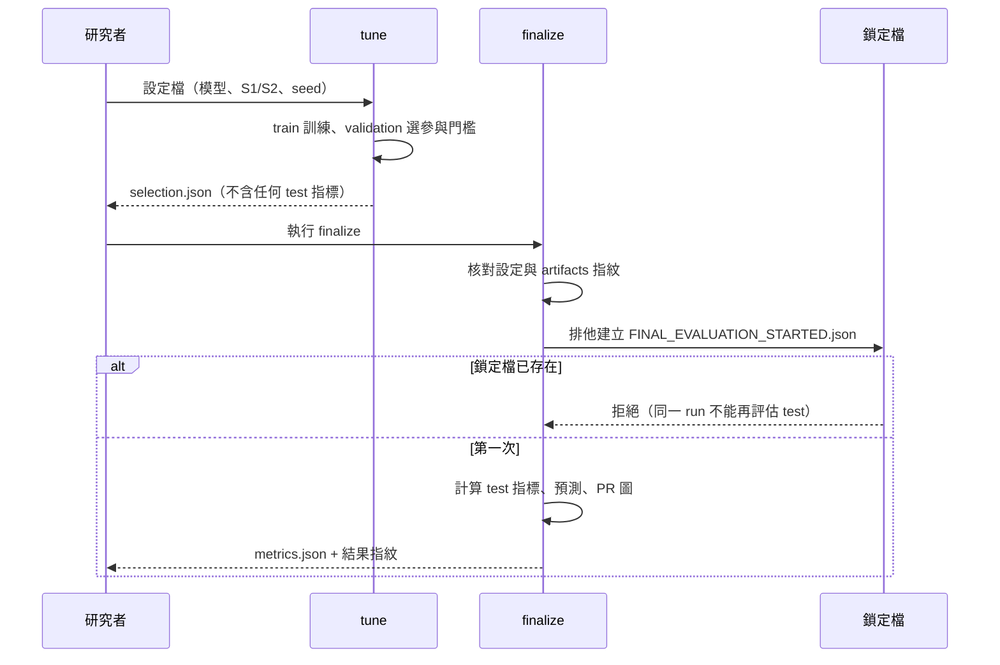
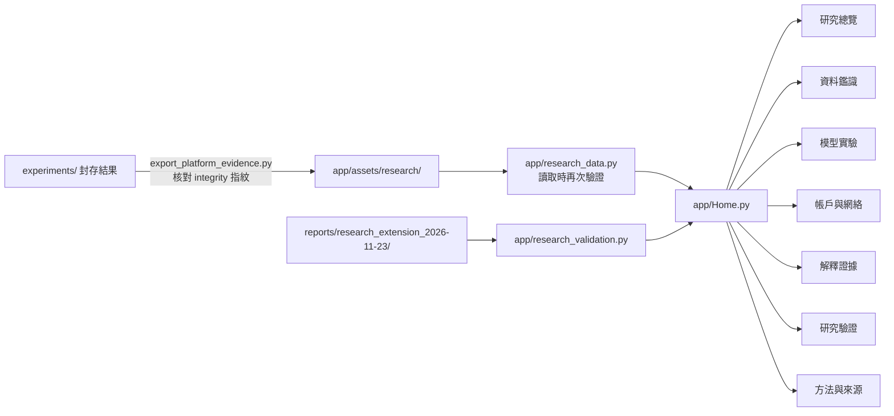
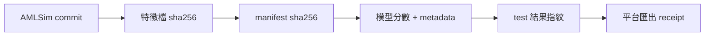

# 論文草稿：系統設計與實作

> 撰寫：成員 C（劉泳頡）｜版本日期：2026-11-24｜對應程式：`main`（PR #10 合併後）
> 本章只描述系統「怎麼設計、怎麼運作」。實驗數字請引用 `reports/` 與 `experiments/` 的封存結果，不在本章重寫。

## 1. 設計目標

AML Insight 是研究原型，不是銀行上線系統。設計時依序考慮以下目標：

| 目標 | 具體做法 |
|---|---|
| **可重現** | 固定資料來源 commit、固定 seeds、`uv.lock` 鎖定套件版本；所有產出檔案記錄 SHA-256 |
| **防止資料洩漏** | 排除 `fraudStep`；標準化只用 train；超參數只看 validation；test 只評估一次並上鎖 |
| **公平比較** | 三個模型共用同一份特徵檔、同一個切分函式、同一組 seeds 與同一套指標 |
| **可解釋** | XGBoost 用 SHAP、GraphSAGE 用 GNNExplainer，並檢查解釋的忠實度與穩定性 |
| **可展示、易使用** | Streamlit 平台只讀取封存結果，組員與評審用瀏覽器即可查看，不需安裝環境 |
| **誠實呈現** | 平台與報告標示「研究用途、不是犯罪證據」，區分正式結果與探索性分析 |

## 2. 系統架構總覽

系統分成六層。上層只依賴下層的「輸出檔案」，不直接呼叫下層的內部函式，因此每一層都可以單獨重跑與檢查。

## 3. 資料處理流程

每個步驟都是一支可單獨執行的腳本，依檔名編號順序執行，輸入與輸出都是檔案。

| 步驟 | 腳本／指令 | 主要輸入 | 主要輸出 | 負責 |
|---|---|---|---|---|
| 0 | `scripts/00_fetch_amlsim_samples.sh` | IBM AMLSim 官方 repo（固定 commit `7338a4b`） | `data/raw/`、`AMLSIM_COMMIT.txt` | A |
| 1–2 | `01_inspect_files.py`、`02_label_quality_analysis.py` | `data/raw/` | 檔案、欄位、標籤與洩漏檢查報告 | A |
| 3 | `03_build_features_graph.py` | `data/raw/` | 特徵表、S1/S2、`edges.parquet`、PyG 圖、E3 時間窗特徵、`feature_groups.json` | A |
| 4–8 | `04_eda.py` … `08_…` | 特徵與圖 | EDA 圖表、洩漏檢查、E2 圖變體、notebook | A |
| 9 | `09_train_graphsage.py` | 特徵、邊、B 的切分函式 | `data/processed/C/E1-<S>-seed<k>/`（分數與 metadata） | C |
| — | `python -m aml_insight.evaluation {split, tune, finalize, explain, aggregate, suite}` | 設定檔 + 上述輸出 | `experiments/<run>/`（指標、預測、鎖定檔、指紋） | B |
| — | `scripts/export_platform_evidence.py` | 封存的 E1 結果 | `app/assets/research/`（平台唯讀資料） | B |

設計重點：

- **原始資料不進 git**（`.gitignore` 排除 `data/`），由腳本重建；只有程式、文件與精簡結果進版本控制。
- **資料清理不以標籤刪資料**：1,684 筆完全重複的交易保留為獨立事件；建圖時同一方向的帳戶對合併成一條邊，另存事件數、金額與時間摘要。
- **兩種特徵設定**：模擬器中金額 < 100 的交易全部發生在詐欺帳戶之間，是一條「捷徑」。因此 S1 用全部合法特徵，S2 移除整個金額群組（含 `init_balance`），用來檢查模型是否只靠金額捷徑。

## 4. 程式模組設計

核心程式放在 `src/aml_insight/`，依功能分成套件：

| 套件 | 主要模組 | 職責 |
|---|---|---|
| `data` | `loader.py`、`clean.py`、`split.py`、`fetch.py` | 讀取並驗證欄位與型別；資料清理；固定 seeds 的分層 60/20/20 切分；雲端自動下載樣本 |
| `features` | `account.py` | 帳戶特徵與特徵群組（amount / behavior / temporal / structure），支援時間窗 `min_step`/`max_step` |
| `graph` | `build.py`、`variants.py` | 建立有向帳戶圖、鄰居特徵、PyG `Data`；E2 的移除邊與保持度數的重接邊 |
| `models` | `rule_based.py`、`xgb.py`、`graphsage.py` | 三種模型 |
| `evaluation` | `runner.py`、`metrics.py`、`report.py`、`suite.py`、`artifacts.py`、`inputs.py` | 選參、一次性 test 評估、指標、彙整與批次設定 |
| `explain` | `shap.py` | XGBoost 的 TreeSHAP 與遮罩忠實度檢查 |

模組之間的介面刻意保持簡單：**帳戶以 `nodeid` 對齊，資料以 DataFrame 或檔案交換**。例如 GraphSAGE 直接呼叫 B 的 `load_features` 與 `stratified_split`，確保三個模型的欄位順序與切分完全一致。

## 5. 模型子系統

| 模型 | 輸入 | 設計 | 類別不平衡處理 |
|---|---|---|---|
| Rule-based | 帳戶特徵 | 依分位數門檻觸發規則，分數為觸發比例 | 不適用 |
| XGBoost | 帳戶特徵（表格） | 樹模型；超參數網格只以 validation AP 選擇 | `scale_pos_weight = 負樣本數 / 正樣本數`（train） |
| GraphSAGE | 帳戶特徵 + 交易圖 | 2 層 `SAGEConv`（mean 聚合）；轉帳邊加反向邊，讓帳戶同時參考轉入與轉出對象 | BCE `pos_weight = 負樣本數 / 正樣本數`（train） |

GraphSAGE（`src/aml_insight/models/graphsage.py`）的防洩漏設計：

1. **前處理**：signed log1p 壓縮長尾金額，再用 **train 帳戶**的平均與標準差標準化。
2. **Transductive 訓練**：全圖的邊與特徵可見，但 loss 只計算 train 帳戶的標籤。
3. **選參**：3 組候選超參數 × 每個 epoch，都只看 validation AP，保留最佳權重；同分取較早者。
4. **不使用 `edge_attr`**：邊上的金額不會繞過 S2 的特徵分組。
5. **輸出**：只輸出 validation 與 test 分數；test 指標一律交給評估層計算。

## 6. 實驗與評估子系統

評估流程的核心是「**test 只能看一次**」。流程分成兩個指令，中間以檔案鎖隔開：

- **切分**：依標籤分層 60/20/20，seeds 0–4，正樣本比例偏差 < 0.005，`manifest.json` 保存帳戶清單。
- **指標**：以 PR-AUC（Average Precision）為主，輔以 Precision@K、Recall@K、F1（門檻由 validation 決定）與 ROC-AUC；因類別不平衡，不使用 accuracy。
- **GraphSAGE 接入**：C 交付 `validation.csv`、`test.csv`（`nodeid,score`）與 `metadata.json`（seed、設定、特徵檔指紋、欄位順序、訓練設定）；評估層核對指紋一致才接受。
- **彙整**：`aggregate` 只納入完整且指紋通過的 run，報告平均、樣本標準差（ddof=1）與最佳值。
- **實驗對應**：E1 模型比較、E2 圖結構與特徵消融、E3 早晚時間窗、E4 解釋案例、E5 跨 seeds 穩定性（重用 E1 結果，不重複評估 test）。

## 7. 可解釋子系統

| 對象 | 方法 | 設計 | 檢查方式 |
|---|---|---|---|
| XGBoost | TreeSHAP（`src/aml_insight/explain/shap.py`） | interventional、probability 空間；背景樣本只取 train | 驗算 base value + SHAP 總和 = 模型分數；遮罩 top-k 特徵觀察分數下降，並和隨機遮罩對照 |
| GraphSAGE | GNNExplainer（`research/2026-11-23/explain_gnn.py`） | PyG `Explainer` + `GNNExplainer`，edge mask 為 object 層級；對查詢帳戶的兩跳子圖做解釋；以 validation 選定的門檻為中心，不重新訓練 | 刪除重要邊後觀察分數變化（遮罩）；跨 seeds 比較重要邊的穩定性 |

兩種解釋使用相同的代表帳戶，方便在 E4 並排比較「XGBoost 看哪些特徵」與「GraphSAGE 看哪些交易關係」。

## 8. 展示平台設計

平台入口為 `app/Home.py`（Streamlit），採**唯讀證據**設計：網站不訓練、不重新評估，只讀取封存結果。

| 工作區 | 用途 |
|---|---|
| 研究總覽 | 三個模型在 S1/S2 的 AP 與 seed 差異、研究證據地圖 |
| 資料鑑識 | 交易時間分布、金額分布、小額交易捷徑檢查、資料品質 |
| 模型實驗 | 5 seeds 的各項指標、PR 曲線、混淆矩陣 |
| 帳戶與網絡 | test 帳戶風險排序、誤判篩選（FP/FN/三模型皆漏判）、一階交易子圖 |
| 解釋證據 | SHAP 全域與個案特徵貢獻、忠實度結果 |
| 研究驗證 | 圖與特徵消融、時間轉移、外部資料方法複驗、解釋可靠性 |
| 方法與來源 | 資料版本、來源檔、SHA-256、研究限制 |

其他設計：

- 目前工作區寫入網址參數 `view`，可直接分享某一頁。
- 資料指紋不符時停止顯示，避免把不同版本的結果混在一起。
- 每頁標示「資料標籤 ≠ 模型預測 ≠ 犯罪證據」。

## 9. 開發環境與部署

| 項目 | 設計 |
|---|---|
| 套件管理 | `uv` 虛擬環境，`uv.lock` 鎖定版本；Python 3.11；`torch<2.12`（2.12 起不提供 macOS 13 wheel） |
| 測試 | `pytest`（目前 62 passed、2 skipped）與 `ruff`；使用小型合成資料，不依賴大型檔案 |
| 平台部署 | Streamlit Community Cloud，連接 GitHub `main`，合併後自動重新部署 |
| 雲端依賴 | `app/requirements.txt` 只列 Streamlit、pandas、NumPy、Plotly，不安裝 torch / XGBoost，降低記憶體與啟動時間 |
| 雲端資料 | 平台只讀 `app/assets/` 與 `reports/` 中已進版本控制的精簡結果；首頁原始資料由 `fetch.ensure_samples` 從 AMLSim 固定 commit 下載 |
| 已知問題 | macOS 上 torch 與 XGBoost 各自帶 OpenMP 函式庫，同一程序使用會當機；以 `OMP_NUM_THREADS=1`（`tests/conftest.py`、`09_train_graphsage.py`）避免 |

## 10. 可重現性與資料完整性

每一層都記錄上一層的指紋。任何一個環節的檔案被改動，下游的核對就會失敗，避免「用 A 版本資料訓練、拿 B 版本資料展示」。

## 11. 設計取捨與限制

| 取捨 | 理由 | 代價 |
|---|---|---|
| 帳戶層級分類，不做交易分類 | AMLSim 只有帳戶標籤 | 無法直接回答「哪一筆交易可疑」 |
| GraphSAGE 採 transductive | 資料只有一張圖，可利用未標記帳戶的關係 | 結果不代表「全新帳戶」的預測能力 |
| 平台唯讀、不做線上推論 | 避免網站上重跑 test、雲端無法負擔 torch | 無法上傳新資料即時評分 |
| 5 seeds 重用同一批帳戶 | 符合專題規模 | 標準差不是獨立資料集的信賴區間 |
| 使用合成資料 | 真實洗錢資料無法公開取得 | 金額捷徑等模擬器特性不代表真實銀行 |

此外，E1 的 test 已在 2026-11-16 檢視過；之後的消融、時間窗與外部資料實驗屬**探索性後續研究**，報告中需與正式結果分開陳述。
