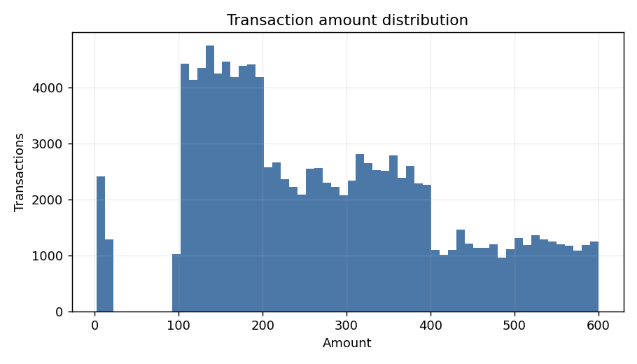
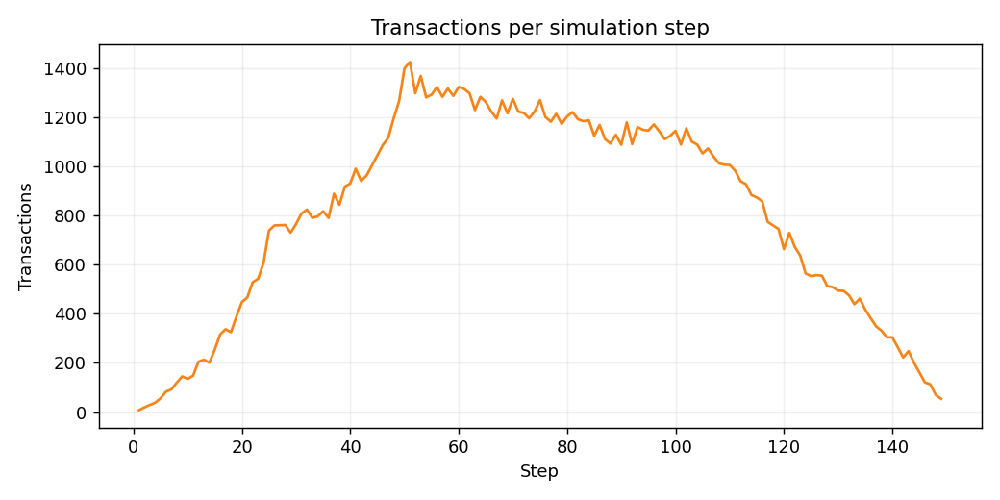
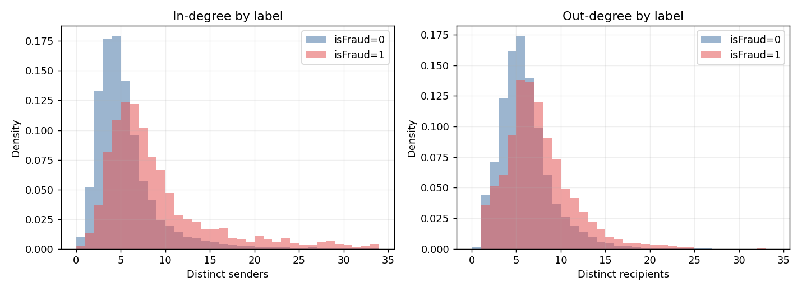
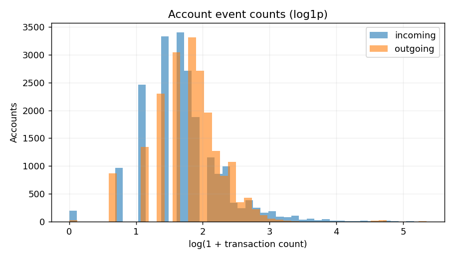
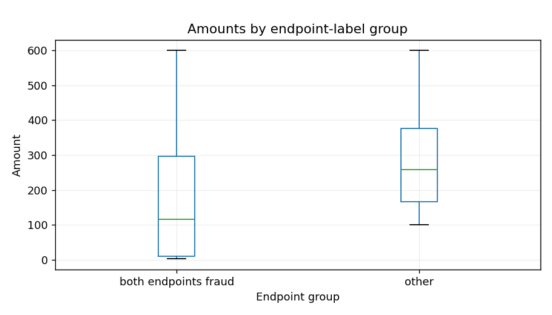
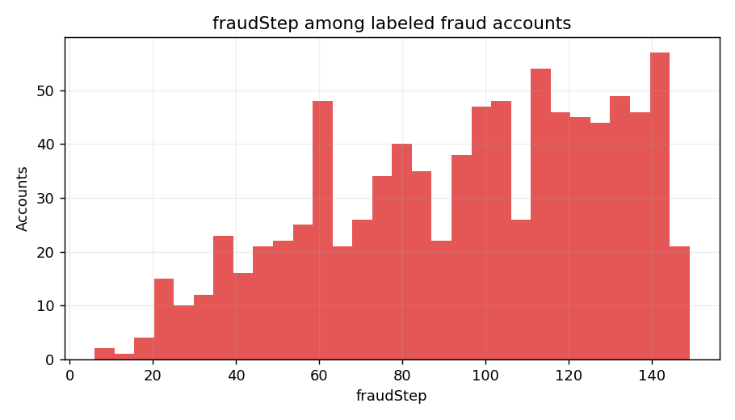

# Member A — Week 1 EDA

主要資料集 `20K_fanin200cycle200`。下方圖表與摘要由原始 CSV 即時計算；全期間圖只用於描述，不代表時間切分模型輸入。

- 帳戶 20,000；詐欺帳戶 1,804（9.02%）
- 交易 120,558；完全重複列 1,684；self-loop 15；無交易帳戶 20

## 1. A_eda_amount_distribution.png

金額呈長尾分布；小額交易區域另需與帳戶標籤關係對照，不能單憑此分布推論犯罪。

## 2. A_eda_transactions_per_step.png

各 step 的交易量用於檢查時間覆蓋與時間窗；step 是模擬步數，不代表實際日曆時間。

## 3. A_eda_degree_by_label.png

依標籤分組比較入度與出度；這些是全期間 EDA 統計，正式預測須依各資料切分重算。

## 4. A_eda_event_counts.png

帳戶事件量偏斜明顯，因此報圖採 log1p；帳戶事件數和不同鄰居數是不同概念。

## 5. A_eda_amount_by_endpoint_labels.png

依兩端帳戶標籤檢視交易金額，揭示合成資料可能存在的金額捷徑；這不是交易真實標籤。

## 6. A_eda_fraudstep.png

fraudStep 只供標籤品質與時間 EDA 使用；它會直接透露標籤，禁止作為模型輸入。
